<div align="center">

<!-- 2-Scene Animated Developer Terminal -->


<br/>

<!-- Matching Terminal Navigation Pills -->
<a href="https://github.com/meetcodz">
  
</a>
<a href="https://www.linkedin.com/in/meet-modi-a80a69385/">
  
</a>
<a href="mailto:YOUR_EMAIL">
  
</a>
<a href="https://codeforces.com/profile/YOUR_CODEFORCES">
  
</a>
<a href="https://leetcode.com/YOUR_LEETCODE">
  
</a>

<br/><br/>


</div>

---

## 🚀 Open Source Contributions // Kubeflow

```zsh
meet@cloud-native:~$ gh pr list --repo kubeflow --author meetcodz --state merged
```

### 📦 [kubeflow/pipelines](https://github.com/kubeflow/pipelines) `(branch: master)`
> *Cloud-Native Machine Learning Workflows orchestration engine (CNCF / Linux Foundation)*
* `├──` 🟢 **[PR #15506](https://github.com/kubeflow/pipelines/pull/15506)** `[MERGED]` — Enhanced backend API server logging & request tracing
* `├──` 🟢 **[PR #15507](https://github.com/kubeflow/pipelines/pull/15507)** `[MERGED]` — Resolved pagination stability & boundary cursor handling
* `└──` 🟢 **[PR #15615](https://github.com/kubeflow/pipelines/pull/15615)** `[MERGED]` — Backend API server stability & log synchronization

<br/>

### 📦 [kubeflow/trainer](https://github.com/kubeflow/trainer) `(branch: master)`
> *Distributed Model Training & Scheduling Operator for Kubernetes*
* `├──` 🐛 **[Issue #4450](https://github.com/kubeflow/trainer/issues/4450)** — Unrecovered panic in Workload-Aware Scheduling webhook & builder
* `│   └──` 🟢 **[PR #4451](https://github.com/kubeflow/trainer/pull/4451)** `[MERGED]` — Resolved panic & added nil-pointer boundary validation
* `├──` 🐛 **[Issue #4452](https://github.com/kubeflow/trainer/issues/4452)** — OptimizationJob API status patch rejection via duplicate keys
* `└──` 🟢 **[PR #4453](https://github.com/kubeflow/trainer/pull/4453)** `[MERGED]` — Deduplicated `listType=map` parameter keys in status patch

---

## 🛠️ Flagship Engineering Projects

* **[Vakya AI](https://github.com/meetcodz)** — Voice-controlled browser IDE. Features Monaco Editor, faster-whisper STT, custom SentenceTransformer intent classification, and FastAPI for real-time diff-based code updates.
* **[Fake News Detection System](https://github.com/meetcodz)** *(1st Place @ DEVKRITI '26)* — End-to-end NLP preprocessing, feature extraction, and ML classification pipeline with prediction confidence and evidence retrieval.

---

## 💻 Tech Stack & Tooling

<div align="center">

<h4>Languages</h4>
<a href="https://skillicons.dev"></a>

<h4>Cloud & Systems</h4>
<a href="https://skillicons.dev"></a>

<h4>Machine Learning & Data</h4>
<a href="https://skillicons.dev"></a>

<h4>Databases & Web</h4>
<a href="https://skillicons.dev"></a>

</div>

---

## 🐾 Virtual Companion & Commit Garden

<div align="center">

<!-- YourTomo Interactive Cat (github.com/knowprasad/YourTomo) -->
<picture>
  <source media="(prefers-color-scheme: dark)" srcset="https://raw.githubusercontent.com/meetcodz/meetcodz/main/dist/pet.svg">
  <source media="(prefers-color-scheme: light)" srcset="https://raw.githubusercontent.com/meetcodz/meetcodz/main/dist/pet-light.svg">
  
</picture>

<br/><br/>

<!-- Git-Bonsai Procedural Commit Tree (github.com/egorthinks/git-bonsai) -->
<a href="https://github.com/egorthinks/git-bonsai">
  
</a>

<br/>
<sub><i>Tree grown procedurally from commit history • Cat reacts dynamically to activity and streaks</i></sub>

</div>

---

## 📊 GitHub Activity & Analytics

<div align="center">


<br/><br/>


</div>

---

<div align="center">

### 💬 Let's Connect

Open to cloud-native systems engineering, open-source infrastructure, and machine learning collaborations.

**Building. Learning. Contributing.**

</div>
