# Meet Modi

### IT Undergrad @ ABV-IIITM Gwalior

  

  

---

##  About Me

- 🎓 **IT Undergraduate** at **ABV-IIITM Gwalior**
- 🌐 **Open Source Contributor** actively contributing to Cloud-Native AI and Machine Learning infrastructure (**Kubeflow**).
- 💻 **Core Interests:** Cloud-Native Infrastructure, Distributed Systems, High-Performance Backend Engineering, and Deep Learning.
- ⚡ **Competitive Programming:** Regular participant in Codeforces, LeetCode, and algorithmic contests.
- 🎯 **Goal:** Contributing to ecosystem-defining open-source projects.
- ⚽ **Fun Fact:** Big football enthusiast on and off the pitch.

---

##  Featured Open Source Contributions

### [Kubeflow](https://github.com/kubeflow)
Cloud-Native MLOps Platform (CNCF / Linux Foundation)

#### 🔹 Kubeflow Pipelines
Repository: [kubeflow/pipelines](https://github.com/kubeflow/pipelines)
- Enhanced backend API server logging, request tracing, and pagination stability.
- [PR #15506](https://github.com/kubeflow/pipelines/pull/15506) — Merged
- [PR #15507](https://github.com/kubeflow/pipelines/pull/15507) — Merged
- [PR #15615](https://github.com/kubeflow/pipelines/pull/15615) — Merged

#### 🔹 Kubeflow Trainer
Repository: [kubeflow/trainer](https://github.com/kubeflow/trainer)
- Discovered and fixed an unrecovered panic in the Workload-Aware Scheduling webhook and builder.
  - [Issue #4450](https://github.com/kubeflow/trainer/issues/4450)
  - [PR #4451](https://github.com/kubeflow/trainer/pull/4451)
- Resolved `OptimizationJob` API server status patch rejection caused by duplicate `listType=map` parameter keys.
  - [Issue #4452](https://github.com/kubeflow/trainer/issues/4452)
  - [PR #4453](https://github.com/kubeflow/trainer/pull/4453)

---

##  Tech Stack & Tooling

<h4>Languages</h4>

<h4>Cloud & Systems</h4>

<h4>Machine Learning & Data</h4>

<h4>Databases & Web</h4>

---

##  Virtual Companion & Commit Garden

<!-- YourTomo Interactive Cat (github.com/knowprasad/YourTomo) -->
<picture>
  <source media="(prefers-color-scheme: dark)" srcset="https://raw.githubusercontent.com/meetcodz/meetcodz/main/dist/pet.svg">
  <source media="(prefers-color-scheme: light)" srcset="https://raw.githubusercontent.com/meetcodz/meetcodz/main/dist/pet-light.svg">
  
</picture>

  

<!-- Git-Bonsai Procedural Commit Tree (github.com/egorthinks/git-bonsai) -->

 
<i>Tree grown procedurally from commit history • Cat reacts dynamically to activity and streaks</i>

---

##  GitHub Activity & Analytics

  

---

###  Let's Connect

Open to collaborations, open-source contributions, and systems engineering opportunities.

**Building. Learning. Contributing.**

